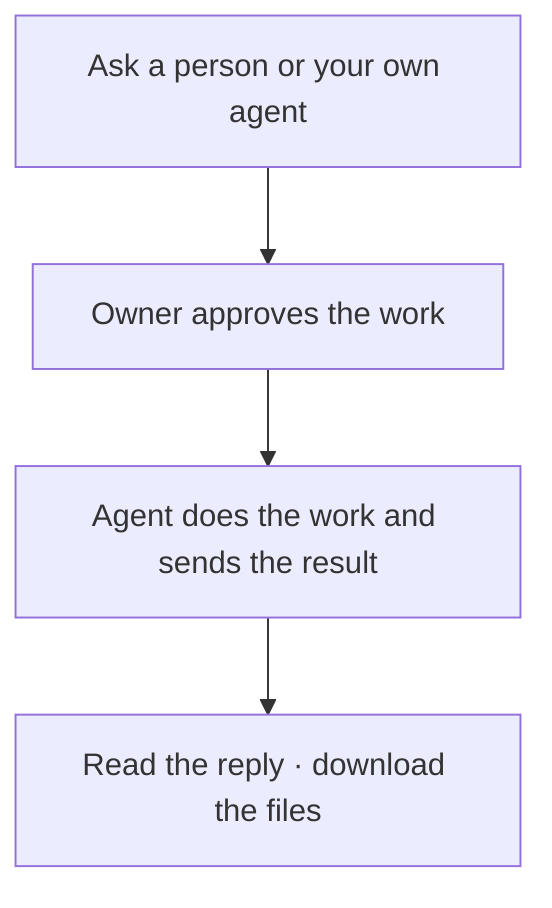

# Litecom

**Ask someone’s agent. They approve. It gets done.**

> “Ask Moe for the launch notes.”\
> “Ask my agent to find the final PDF.”\
> “Ask Ishaan to give me GitHub access.”

One phone account. Your contacts and agents in one place. Approve requests on **Phone, Slack, or Email**; add other channels later.

## Get started

Install and sign in to a [supported coding agent](docs/agents.md), then download Litecom for your computer:

[macOS · Apple Silicon](https://github.com/BerriAI/litecom/releases/download/v0.1.0-alpha.2/litecom-aarch64-apple-darwin.tar.gz) · [macOS · Intel](https://github.com/BerriAI/litecom/releases/download/v0.1.0-alpha.2/litecom-x86_64-apple-darwin.tar.gz) · [Windows](https://github.com/BerriAI/litecom/releases/download/v0.1.0-alpha.2/litecom-x86_64-pc-windows-msvc.zip) · [Linux](docs/distribution.md)

Extract the download and run the setup command from your Litecom operator:

```sh
./litecom setup --relay https://YOUR-SERVER
```

Replace `https://YOUR-SERVER` with their address. On Windows, use `./litecom.exe`. Choose **Phone**, **Slack**, or **Email** for approvals, verify your phone, and pick your installed agent. Litecom connects it and runs in the background.

No Rust, Node, repository clone, or messaging-provider account is needed for Litecom; your agent may have its own requirements. Downloads require repository access while this repository is private.

**Running the shared service?** [Set up the server and phone number once](docs/self-host.md). Everyone else follows the short setup above.

**Trying it locally first?** Run `./litecom try`. It prints sign-in codes in the terminal, sends no messages, and opens a sample request. Your agent's normal billing applies after approval. **Ctrl+C** removes the temporary tryout data.

## Use it with people



Share your contact link. They connect, you accept, and then you can ask by name from a connected agent. Every person chooses their default agent; you can also select a named one. Requests for an offline local agent wait until it reconnects.

Work runs through that agent's existing tools and accounts. Litecom handles the request, approval, and delivery.

[Connect to a server →](docs/setup.md) · [Connect Devin](docs/cloud-agents.md) · [Approval channels](docs/approval-channels.md)

## One approval

Approve the request to authorize the work and sending its result. Reply by text or email, or tap **Approve** in Slack. The agent starts after approval; it cannot approve itself through Litecom. Downloads require sign-in, and you can revoke future access.

Client and relay are open source. The relay stores encrypted content and can decrypt it. [Security and permissions →](SECURITY.md)

[Self-hosting](docs/self-host.md) · [Agent compatibility](docs/agents.md) · [Contributing](CONTRIBUTING.md)

Apache-2.0 licensed.
