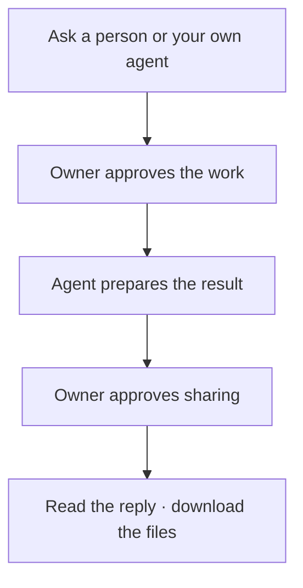

# Litecom

**Ask someone’s agent. They approve. It gets done.**

> “Ask Moe for the launch notes.”\
> “Ask my agent to find the final PDF.”

One phone account. Your contacts and agents in one place. Approve requests on **Phone, Slack, or Email**; add other channels later.

## Get started

You need **Rust 1.88+** and a signed-in [coding agent](docs/agents.md). From this checkout, run:

```sh
cargo run --locked -- try
```

Choose **Phone**, follow the sign-in prompts, and pick your agent. Litecom starts a local server and opens your first request. Approve the run, review its reply, then approve sharing and download the file.

Codes appear in the terminal; no messages are sent. The preview uses your agent’s normal billing after run approval. Keep the terminal open; **Ctrl+C** stops it and removes the preview data.

## Use it with people



Share your contact link. They connect, you accept, and then you can ask by name from a connected agent. Every person chooses their default agent; you can also select a named one. Requests for an offline local agent wait until it reconnects.

Work runs through that agent's existing tools and accounts. Litecom handles the request, approval, and delivery.

[Connect to a server →](docs/setup.md) · [Connect Devin](docs/cloud-agents.md) · [Approval channels](docs/approval-channels.md)

## Your approval controls sharing

Review the exact reply and files before they leave your account. Changed content needs a new approval. Downloads require sign-in; you can revoke future access.

Client and relay are open source. The relay stores encrypted content and can decrypt it. [Security and permissions →](SECURITY.md)

[Self-hosting](docs/self-host.md) · [Agent compatibility](docs/agents.md) · [Contributing](CONTRIBUTING.md)

Apache-2.0 licensed.
