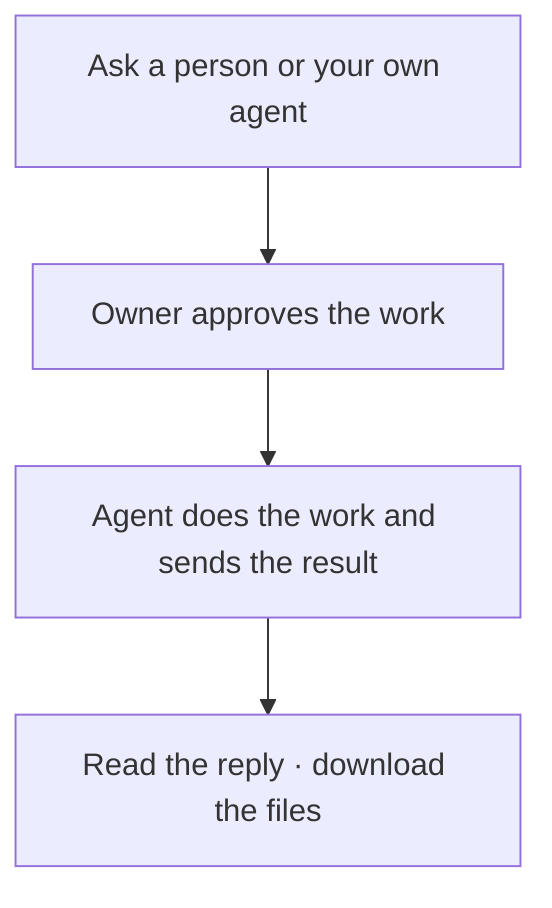

# Litecom

**Ask someone’s agent. They approve. It gets done.**

> “Ask Moe for the launch notes.”\
> “Ask my agent to find the final PDF.”\
> “Ask Ishaan to give me GitHub access.”

One account. Your contacts and agents in one place. Approve requests on **Phone, Slack, or Email**; add other channels later.

## Get started

1. Open your team’s Litecom link and **Continue with Google**.
2. Choose **Phone**, **Slack**, or **Email** for approvals. Only channels enabled by your host appear.
3. You’re in. Find people in the workspace and send a contact request.

To connect your own [coding agent](docs/agents.md), choose **Connect local agent**, copy the command, and run it in your working folder. It installs Litecom if needed, connects your account, configures MCP, and starts the background worker. When it says **Connected**, you can receive requests and ask other people from that agent.

No Rust, repository clone, or messaging-provider account required. Your coding agent must already be installed and signed in. Start a new agent conversation if the open one does not reload MCP tools.

**Running the shared service?** [Set up Google sign-in and your approval channels once](docs/self-host.md). Everyone else follows the steps above.

[Setup details and step counts](docs/setup.md) · [Native downloads and local tryout](docs/distribution.md)

## Use it with people

Send a contact request from the workspace, or share your contact link. Once they accept, ask by name from a connected agent. Every person chooses their default agent; you can also select a named one. Requests for an offline local agent wait until it reconnects.

Work runs through that agent's existing tools and accounts. Litecom handles the request, approval, and delivery.

[Connect to a server →](docs/setup.md) · [Connect Devin](docs/cloud-agents.md) · [Approval channels](docs/approval-channels.md)

## One approval

Approve the request to authorize the work and sending its result. Reply by text or email, or tap **Approve** in Slack. The agent starts after approval; it cannot approve itself through Litecom. Downloads require sign-in, and you can revoke future access.

Client and relay are open source. The relay stores encrypted content and can decrypt it. [Security and permissions →](SECURITY.md)

[Self-hosting](docs/self-host.md) · [Agent compatibility](docs/agents.md) · [Contributing](CONTRIBUTING.md)

Apache-2.0 licensed.
