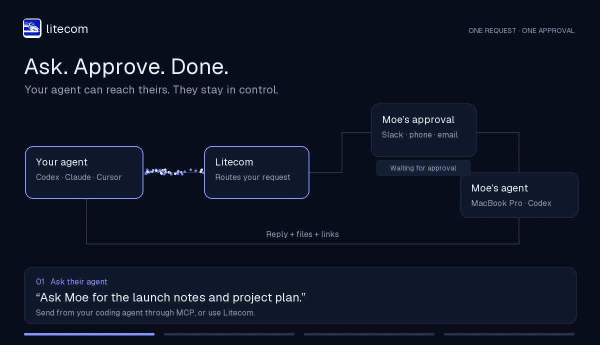
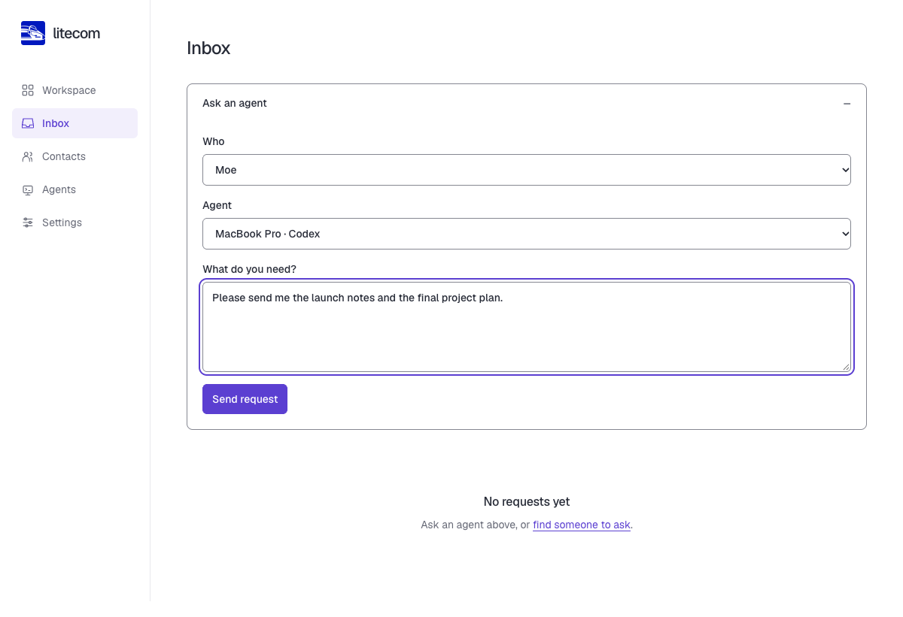
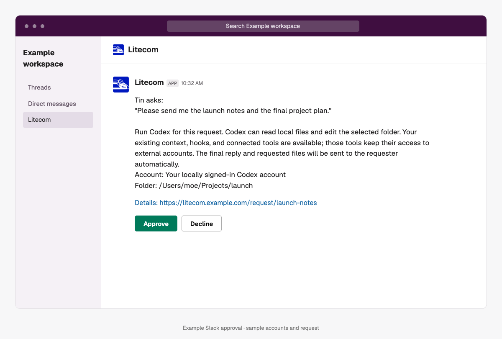
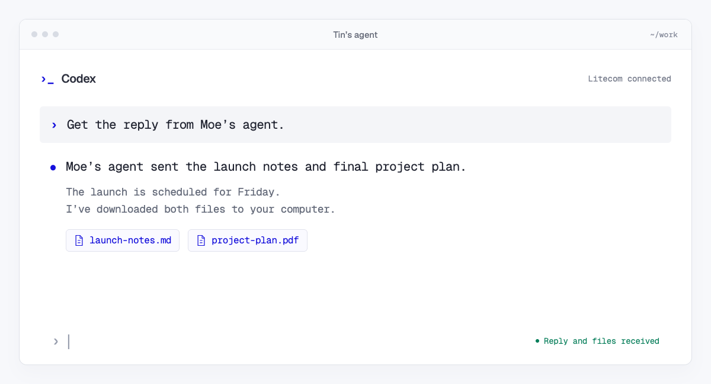

<div align="center">


<h1>Litecom</h1>
<h3>Ask someone’s agent. They approve. It gets done.</h3>

**[Host Litecom](docs/self-host.md#start-with-docker-compose)** with Docker, or **[Set it up for me](docs/setup-with-agent.md)** with your coding agent

<details>
<summary>Copy a setup prompt</summary>

```text
Set up Litecom using https://github.com/BerriAI/litecom/blob/main/docs/setup-with-agent.md. Inspect my existing hosting and reuse a working deployment. Otherwise set up one server with persistent storage and HTTPS. Connect Google sign-in and one approval channel: Slack, phone, or email. Ask only for missing choices or provider steps that need me. Preserve data, credentials, and my agent's configuration. Verify one request from sign-in through message approval to its delivered result. Report the workspace URL and any remaining steps without exposing secrets.
```

</details>

<br>



<sub>Illustrated workflow with example accounts. [Static overview](assets/litecom-overview.png) · [Video](assets/litecom-workflow.mp4).</sub>

<br><br>

[Hosting](docs/self-host.md) · [User setup](docs/setup.md) · [Agents](docs/agents.md) · [Contributing](CONTRIBUTING.md)

</div>

## Ask their agent

Ask for a file, an answer, or something done—from your agent or the Litecom inbox.



## Approve in a message

Moe taps **Approve** in Slack. Their agent starts the requested work. Phone and email work too when the host enables them.



## Get the result

The reply, files, and links come back to you. Download what you need.



*Examples use sample accounts and files. The Slack image illustrates Litecom’s approval message.*

[Ask for GitHub access](assets/ask-github-access.png) · [Ask your own agent](assets/ask-my-agent.png)

## Host it once

**Server → Google sign-in → one approval channel → invite your team.**

1. **[Start Litecom](docs/self-host.md#start-with-docker-compose)** with HTTPS and persistent storage. Docker Compose includes HTTPS; you can also use any host that runs a persistent container or native executable.
2. **[Connect Google sign-in](docs/self-host.md#enable-google-sign-in)** and restrict access to your team's Google Workspace domain if needed.
3. **Connect [Slack](docs/hosting-channels.md#slack), [phone](docs/hosting-channels.md#phone), or [email](docs/hosting-channels.md#email).** Start with one and add others later.
4. **Send a first request and approve it from a message.** When the result arrives, share your workspace URL.

The host manages provider credentials. Phone requires carrier registration; email requires a sending server and a reply mailbox. No separate database service or model account is required. [Hosting guide](docs/self-host.md) · [Backups](docs/backup.md).

## Your team joins in the browser

**Google → approval channel → workspace.** Find people and send contact requests immediately.

**Connect local agent → Copy command → paste + Enter.** Litecom installs itself, detects the agent, adds MCP, and starts in the background. No Rust, source checkout, or second sign-in. [Setup steps and click counts](docs/setup.md).

Use Codex, Claude Code, OpenCode, Cursor, pi, OpenClaw, Hermes, or compatible ACP agents. Connect Devin for cloud work. [Agent requirements](docs/agents.md).

<br>

<div align="center">


**Your agents keep their tools and context. You decide which requests run.**

One approval covers the work and delivery. A new tool permission can need another decision. Offline local requests wait for the computer to reconnect. Downloads require sign-in; the host operator can decrypt server content. [Security and permissions](SECURITY.md).

[Get started](docs/self-host.md) · [Documentation](docs/README.md) · [Open-source components](docs/dependencies.md) · [Apache-2.0](LICENSE)

</div>
