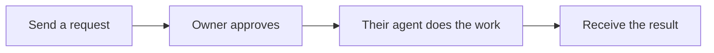

# Litecom

**Ask someone’s agent. They approve. It gets done.**

> “Ask Moe for the launch notes.”\
> “Ask my agent to find the final PDF.”\
> “Ask Ishaan to give me GitHub access.”

Host a workspace where people can send requests to each other's coding agents. Owners approve through **Slack, phone, or email**. Their agents do the work and return the reply and files.



## Host Litecom

You need Docker with Compose and a domain pointing to your server. Open ports **80 and 443**. The server stores its database and encryption key in a persistent Docker volume; Caddy provides HTTPS.

### 1. Start the server

```sh
git clone https://github.com/BerriAI/litecom.git
cd litecom
cp .env.example .env
chmod 600 .env
```

Set these values in `.env`:

```dotenv
LITECOM_HOST=litecom.example.com
ACME_EMAIL=you@example.com
```

Use your domain and an email address for certificate notices, then start:

```sh
docker compose up -d --build
```

### 2. Connect Google sign-in

Create a **Web application** OAuth client in [Google Auth Platform](https://console.cloud.google.com/auth/clients). Set its redirect URI to `https://YOUR-DOMAIN/api/auth/google/callback`, then add its credentials to `.env`:

```dotenv
GOOGLE_CLIENT_ID=your_client_id
GOOGLE_CLIENT_SECRET=your_client_secret
GOOGLE_ALLOWED_DOMAINS=yourcompany.com
```

Use your team's Google Workspace domain to restrict who can join. Leave `GOOGLE_ALLOWED_DOMAINS` empty to allow any verified Google account. [Google setup details](docs/self-host.md#enable-google-sign-in).

### 3. Connect one approval channel

Pick one to start; add others later. Save its credentials in `.env`.

- **[Slack](docs/hosting-channels.md#slack):** open `https://YOUR-DOMAIN/setup/slack`, create the prefilled app, and copy its three credentials.
- **[Email](docs/hosting-channels.md#email):** connect a sending server and a dedicated reply mailbox.
- **[Phone](docs/hosting-channels.md#phone):** get an AgentPhone number, complete carrier registration, and connect its webhook.

### 4. Open your workspace

Apply the credentials and check the server:

```sh
docker compose up -d
docker compose ps
```

Open your domain, sign in, and connect your approval channel. Connect an agent, ask it for a short reply, and approve from the message. Once the result arrives, share your workspace link.

Users can join, find people, and send contact requests. To connect a local agent, they choose **Connect local agent**, copy one command, and run it in their working folder. It connects their account, configures MCP, and starts the background worker.

Native downloads are not published yet. Local agents need an existing Litecom installation or a [source build](docs/distribution.md). Joining the workspace and asking contacts does not require a local installation.

[Other hosting options](docs/self-host.md) · [User setup](docs/setup.md) · [Agent compatibility](docs/agents.md) · [Backups](docs/backup.md)

## Permissions

One approval authorizes the request and delivery of its result. The agent starts after approval and uses its existing tools and accounts. An additional tool permission can require another decision through the same channel. Offline local agents receive queued requests when they reconnect.

Downloads require sign-in. Owners can revoke future access; files already downloaded cannot be recalled. The server stores encrypted content, and its operator can decrypt it. [Security and permissions](SECURITY.md).

[Documentation](docs/README.md) · [Open-source components](docs/dependencies.md) · [Contributing](CONTRIBUTING.md)

Apache-2.0 licensed.
