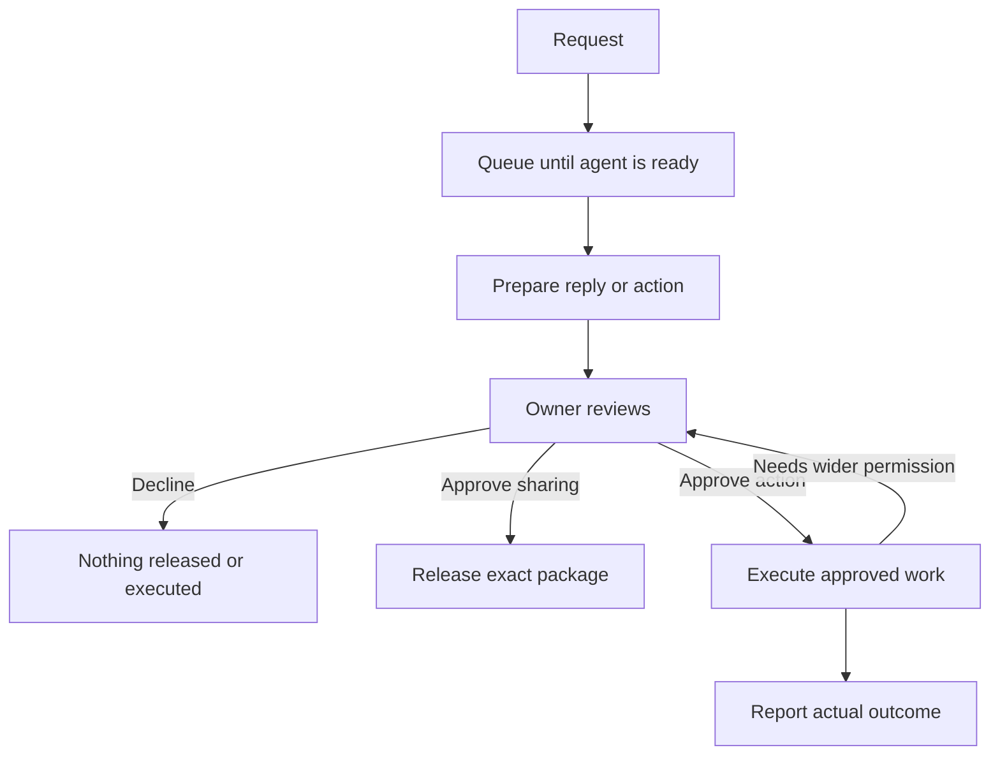

# Litecom setup and flows

**Proposed controls and counts; not a tested product.** These cover the MVP’s supported experiences. Provider dialogs, installation, and typing remain visible additions.

[Overview](README.md) · [Implementation](IMPLEMENTATION.md)

## Count the actual effort

An Enter submission, button, or link activation counts as one action. Arrow-key navigation, typed fields, reading codes, scrolling, app switching, and folder navigation are separate effort. Counts start at the surface named in each row. Opening Litecom or navigating to that surface is extra unless listed.

The standard route uses the operated relay. A compatible authenticated local or cloud agent is available. If no coding agent is installed, setup shows the next installation step and preserves the account connection. One folder is visible in the picker. A detected display name is shown and editable; if none is available, entering a name adds one submission.

## Install and set up

The signed installer bundles the runtime, registers the background service, and opens the terminal wizard. Users do not install a language runtime or edit configuration. `litecom` is also a shortcut to reopen it. All labels and commands here are proposed.

| # | Phone route, starting with wizard open | Work besides activation |
| --- | --- | --- |
| 1 | Choose Phone | First prompt: “Where do you want to approve requests?” |
| 2 | Submit number | Type number. Visible text: Enter sends a code and enables request/status texts |
| 3 | Verify code | Read and enter SMS code |
| 4 | Choose what powers your agent | Confirm the detected agent, context access, native model usage, and background operation |
| 5 | Choose a folder | Opens native picker |
| 6 | Select folder | Navigate if necessary |
| 7 | Allow this folder | Confirms the read scope; modifying it requires task approval |

**Phone target: 7 controls and 2 typed fields**, assuming a detected name and combined sign-in/device confirmation. **Email target: 9 controls and 3 typed fields**, adding email address submission and verification to phone signup. Reading email for responses is a separate connection; choosing Email for notifications never grants mailbox access.

**Slack target: 8 + S + B controls.** Choose Slack → verify phone → connect Slack → provider sign-in (`S`) and app installation if missing (`B`) → confirm this computer → choose harness and folder. The browser connection shows a code matching the terminal. Slack sign-in and bot permissions are separate provider flows. An existing installation can remove `B`; workspace policy may require an administrator.

From the download page, total activations are **`1 + I + C + N + F + H + X`**:

- `1`: Download. `I`: installer, launch, and OS permission controls.
- `C`: the channel’s setup count above.
- `N`: code-reading/navigation or an unavailable display name. `F`: extra folder navigation.
- `H`: additional harness login, trust, or reload steps. `X`: other provider controls, such as model billing if needed.

These are not assumed to be zero. Measure clean installations before advertising a total or “one click.” A package can install with one command; the full journey still includes authentication and consent.

After checks pass, show **“Ready · Phone · Claude Code”** and **Share my contact link**. Show a failed check and its fix instead of “Ready” when sign-in, source access, or background startup fails. The first real success is a completed request, not this readiness check.

## Current implementation: measured setup

The Rust terminal/browser test completes setup with **3 terminal Enter presses, 3 browser buttons, and 3 typed fields**: choose Phone; enter name, number, and code; connect the agent; confirm the detected agent; accept the current folder. The channel is carried into the browser. The test installs a temporary macOS LaunchAgent and checks its real queue heartbeat.

The test uses local delivery and a deterministic native-process fixture. It excludes binary installation, native-agent installation/authentication, the setup command/server address, code reading, and OS prompts. Email setup is now also tested locally: eight activations and five fields. Slack is implemented with protocol fixtures; its real provider controls and the hosted default remain unvalidated. The proposed 7/9/8 targets above describe the earlier design; see the [current setup guide](../setup.md) for measured behavior and recovery.

Native runners currently require **Approve run**, then **Approve** for the exact response. They reuse native permissions and do not silently allow a denied tool. A prepared manual reply needs only the sharing approval.

## Normal use

```text
Litecom · Ready
Approvals: Phone    Main harness: Claude Code

  › Ask someone
    Requests
    Contacts
    Settings
```

One question at a time. Back preserves progress. Errors offer Retry or Change connection. Closing the window leaves the agent running; Pause agent is available in Settings.

| Change, starting in Settings | Controls | Additional work |
| --- | --- | --- |
| Add Phone or Email | 4: Approval channels → Add Phone / Add Email → submit address/number → verify code | Enter and read code |
| Add Slack | 3 + S + B: Approval channels → Add Slack → confirm browser connection | Slack sign-in/install; existing Litecom authentication may need renewal |
| Change main harness | 2: Main harness → select replacement | Required login; show available context and any limitations before selection |
| Add a visible folder | 4: Sources → Choose folder → select → allow | Folder navigation |
| Read email or use another service | Ask the selected agent through the same request flow | Uses that agent's existing tools and login; missing access is resolved in the agent's normal setup |
| Connect another detected MCP client | 2: Connected apps → Connect beside client | Harness trust/reload controls |
| Pause or resume background work | 1 | Queued requests are preserved |

A newly connected channel joins the same account and receives future approval notices. Contacts survive channel changes. Verify the new identity while signed into the existing account; never silently merge two accounts. Keep at least one usable sign-in/recovery method.

## Add a contact once

| Starting point | Flow | Controls |
| --- | --- | --- |
| Alex, Contacts open | Share my link copies it | 1; sharing/paste/send in messaging app adds actions |
| Theo, signed in, invitation message visible | Open link → Add Alex | 2 |
| Alex, signed in, connection notice visible | Open notice → Add Theo | 2 |
| Theo, new user, invitation message visible | Open link → choose Phone/Email → send code → verify code → Add Alex | 5; name, address/number, and code entry; code-reading extra |
| Theo, new user choosing Slack | Open link → choose Slack → provider sign-in/install → Add Alex | 3 + S + B; an existing app installation can remove B |
| User with Theo’s link, Contacts open | Add contact → paste link and submit | 2; Theo still accepts |

From the main menu, opening Contacts adds 1. The connection is mutual once both accept. An invite link identifies an account; it grants no file access and does not start a model run. Only accepted contacts can submit work. Share links through existing messaging; Litecom sends no unsolicited invitation SMS.

Contact names are editable labels over stable account IDs. For two Theos, show both with distinguishing account details and ask for one selection. Unknown “Theo” offers Add contact. Removing or blocking a contact stops new requests; existing shared packages and external permissions have their own revocation controls.

## Ask for something

| Starting point | Experience | Controls |
| --- | --- | --- |
| Connected harness open | “Ask Theo for the Acme proposal” → send | 1 message; any harness tool consent extra |
| Litecom main menu open | Ask someone → Theo → type request and submit | 3 |
| Signed-in browser, contact page open | Type request → Send | 1 |
| Existing request open | Add a follow-up → submit | 2; creates new work requiring its own approval |

The same entry accepts **“Ask Ishaan to give me Write access to org/repo.”** His agent uses its existing tools to resolve the repository, recipient, and requested permission. Unclear details require clarification. There is no separate GitHub form or Litecom GitHub connection; this is an ordinary agent request.

The requester can attach files or links. Send only the request and attachments they selected; their agent’s unrelated context stays private. Show queued, preparing, waiting for approval, executing, or complete truthfully.

## Review, approve, or revise

Start with the notification visible and its browser signed in.

| Decision | Flow | Controls |
| --- | --- | --- |
| Share the prepared reply/files | Open review → Approve and send | 2 |
| Authorize an action or bounded task | Open review → Approve and run | 2 |
| Decline | Open review → Decline | 2; reason optional |
| Edit a reply | Open review → Edit reply → Approve and send | 3 + editing |
| Remove an attachment | Open review → deselect → Approve and send | 3; each additional deselection adds 1 |
| Ask for a revision | Open review → Request changes → submit instruction → open new notice → approve | 5 + instruction |
| Approve with review already open | Approve and send / Approve and run | 1 |

For **sharing**, show the exact recipient, reply, and attachment snapshot. For **actions**, show what will change, where, whose credentials will be used, the allowed scope, and any publication included. Let users expand command/diff details. No extra confirmation modal follows an explicitly labeled approval.

For example, the agent's proposed operation should make these details clear. This is the information in a generic permission review, not a GitHub-specific screen:

```text
Alex requests Write access

Repository   org/repo
Recipient    @alex
Change       No access → Write
Acting as    Ishaan

[Approve once]  [Decline operation]
```

The selected agent performs the work with its existing GitHub connection. If it lacks access, it reports that limitation and directs its owner to the agent's normal connection flow. Litecom does not add a provider-specific onboarding step. Approval cannot override GitHub's own permissions.

An existing collaborator's access may update directly. A new collaborator may get an invitation. The agent reports the actual outcome and any invitation link; it must not claim active access before verifying it. The recipient handles any required acceptance on GitHub. A follow-up request can ask the agent to check the result. These provider steps vary and are not included in Litecom's approval count.

For a larger coding task, one approval can cover an explicit scope such as “change this checkout, run its tests, and open a PR in this repository.” The harness can continue within enforceable permissions. A new target, permission, or external effect pauses for another review: normally 2 controls from its new notification. Arbitrary multistep work cannot honestly promise one approval in every case.

## First review on a new device

| Channel used to sign in | Extra controls after opening review |
| --- | --- |
| Phone | 2: send code → verify; number/code entry and SMS navigation extra |
| Email | 2: send code → verify; address/code entry and mailbox navigation extra |
| Slack | 1 + S: Continue with Slack → provider sign-in/consent |

A desktop login does not authenticate the phone browser. First SMS approval: **4 controls**; subsequent approvals: **2** while signed in. Notifications are links to a request, not credentials. The owner authenticates before acting.

After a decision, update the original Slack notification and all live review pages. Send a completion notice over connected SMS/email channels; previously delivered messages cannot be edited. When execution continues, distinguish **Approved**, **Running**, and the actual outcome.

## Receive results

| Starting point | Flow | Controls |
| --- | --- | --- |
| Requester’s agent actively subscribed/checking | Retrieve released response or execution receipt | 0 human actions |
| Idle/closed harness | “Check my Litecom requests” | 1 message, plus reopening if needed |
| Signed-in browser, completion notice visible | Open response → Download file / Download all | 2 |
| Response already open | Download | 1 |
| Action completed | Read result and follow its PR, repository, or other result link | 1 to open a visible result link |

An unauthenticated browser adds its sign-in flow. Browser recipients need no installation. A browser download is one click; acknowledging it with **Mark received** is one additional click. CLI/MCP downloads verify and acknowledge the file automatically. “Available” means accessible, “received” means retrieval was acknowledged, and “downloaded” means transfer completed. None proves a person read it.

An action’s approved receipt can include status and the resulting URL. New private messages/files outside the approved scope return to review. Stopping a Litecom download link does not undo a completed deployment, PR, or GitHub permission change.

## Waiting and recovery



| Situation | Outcome and next action |
| --- | --- |
| Computer asleep, offline, paused, or busy | Queue; resume when ready. No repeated human action |
| Computer sleeps after draft upload | Sharing can still be approved. Local execution waits for the computer |
| Harness/source login expired | Reconnect: 1 control + provider steps; retain the request |
| Unsupported context or hook | Name what cannot be used; offer a compatible harness or interactive continuation |
| File missing or source unreadable | Review a partial reply or request changes; never fabricate a result |
| Action outside available authority | Show required access/administrator; no false success |
| Run fails | Retry: 1 control after fixing the cause; changed work requires fresh approval |
| Declined, cancelled, or expired | No new release/execution. Send again: 1; new approval required |
| Requester cancels while work is running | Request stop: 1. Show completed effects; cancellation is not rollback |
| Same request approved twice | Return the stored decision; do not launch duplicate execution |
| Transfer/publication interrupted | Retry the same approved snapshot automatically; Retry download: 1 if needed |
| Execution result uncertain after disconnect | Check the provider’s actual state before retrying a write |
| External action partially succeeds | Show each completed/pending effect; do not claim an atomic rollback |
| SMS/email delivery fails or Slack is removed | Use other connected channels; retain terminal Requests access; reconnect/resend as needed |
| OTP expires | Preserve address/number; Resend: 1 after cooldown |
| Phone lost or channel unavailable | Use another linked identity or trusted device/recovery method; reverify replacements |
| Withdraw shared content | Stop sharing: 1 from request; downloaded copies remain |
| Undo an external change | Open a separate, explicit reversal request where the provider supports it |

Test from download through an opened received file **and** through confirmed GitHub access. Record activations, typing, app switches, waits, and administrator handoffs. The counts above become release claims only after those complete routes pass.
