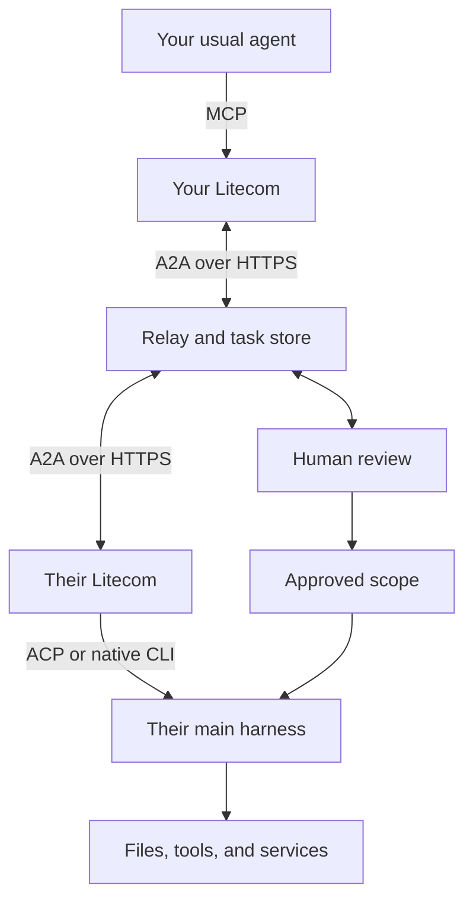

# Litecom implementation proposal

**Target architecture and release requirements.** The [current setup guide](../setup.md) and [release evidence](../release-readiness.md) distinguish implemented behavior from remaining work.

[Overview](README.md) · [Setup and flows](FLOWS.md)

## One background agent, one relay

Litecom owns identity, contacts, durable requests, approvals, and delivery. The selected harness supplies reasoning, context, and execution. The OS service stays alive after the terminal closes; model work happens on requests, not an endless model polling loop. Start with one running job per computer and persistent queues. No separate workflow engine or message broker.

After initial setup, no per-request approval should require returning to the computer. Request and additional tool decisions go through the selected Phone, Slack, or Email channel. Adapters must forward necessary permission decisions remotely or report an explicit unsupported operation; a hidden local confirmation prompt cannot be part of the normal flow.

Use one Rust repository and binary: a terminal client, the background worker, and a relay with Tokio, Axum, SQLite, encrypted payload storage, and small browser pages. Computers connect outbound. The relay routes requests and stores status; users do not open ports. Local wakeups use an authenticated outbound notification stream and resume from durable task state.

Litecom connects to existing local and cloud agents and reuses their supported authentication. It does not ship or maintain a reasoning agent, model connection, or general-purpose tool loop. If no coding agent is installed, setup explains how to install and sign in to a supported agent; saved account setup is preserved. Self-hosters configure the relay and its messaging providers, not a Litecom model service.

## Reuse open source

Use credible existing open-source projects for protocol clients, agent adapters, provider transports, and packaging. Keep custom code focused on Litecom's account/contact model, request routing, review state, and controlled delivery. Evaluate maintenance, licensing, actual compatibility, permissions, and setup burden before adoption. Prefer released dependencies over new internal implementations; for Pi, use `pi-acp` through the shared ACP client.

## Protocols with specific jobs

| Standard | Use in Litecom |
| --- | --- |
| [A2A 1.0](https://a2a-protocol.org/v1.0.0/specification/) | Agent Cards, messages, durable tasks, status, cancellation, and released artifacts; JSON-RPC over HTTPS first |
| [MCP](https://modelcontextprotocol.io/docs/getting-started/intro) | Expose Litecom in existing agents and connect the selected runner to tools/data |
| [ACP](https://agentclientprotocol.com/get-started/introduction) | Start and control compatible harness sessions; use supported permission callbacks |
| OAuth 2.0 / OpenID Connect | Provider connections and Slack identity; browser-based terminal pairing uses the device authorization flow |
| HTTPS and ordinary authenticated downloads | Move file bytes without forcing large payloads into model context |

The Rust implementation uses the official MCP and ACP Rust SDKs and the community `a2a-protocol-types` crate. Pin released versions that interoperate; do not mix A2A 0.3 wire examples with 1.0. Independent A2A interoperability and live ACP adapter validation remain release checks. Optional streaming accelerates updates; polling remains a fallback. Avoid WebRTC, a public agent directory, and a second proprietary agent messaging protocol.

[ANP](https://github.com/agent-network-protocol/AgentNetworkProtocol) is not an MVP dependency. Its decentralized identity, discovery, and cross-domain messaging could be useful for federation between independently operated services. The current phone account, contact authorization, and approval model does not need a second identity system. Reconsider it when a concrete external service requires that interoperability; self-hosting alone is not that requirement.

The relay hosts discoverable Agent Cards and authenticated per-account A2A endpoints. Contacts resolve names to those endpoints and stable IDs. A standards client can participate with the same authentication and contact authorization. An Agent Card is discovery, not permission, and exposes no private memory/tool inventory. Arbitrary federation between independently administered relays is a later deployment feature.

### Keep public tasks separate from private preparation

| Litecom phase | A2A state |
| --- | --- |
| Queued | `SUBMITTED` |
| Preparing, waiting for owner approval, executing | `WORKING`, with a readable phase in namespaced metadata |
| Requester must clarify or accept an invitation | `INPUT_REQUIRED` |
| Approved response available, or requested action verified complete | `COMPLETED` |
| Owner declines / requester cancels / execution fails | `REJECTED` / `CANCELED` / `FAILED` |
| Previously expired request | Remains unavailable; new requests have no automatic expiry |

Use the SDK’s actual enum names, including its required prefix. Owner approval is application authorization; it is not an instruction for the requesting agent to approve itself. Revoking a completed result changes access, not its historical task state. Receipt acknowledgement is separate from A2A completion: the receiving adapter/page confirms retrieval; an attempted HTTP response alone is insufficient.

Only safe progress is visible before approval. Private drafts, source filenames, tool output, and reasoning must not leak through task history, streams, or artifacts. The single request approval authorizes execution and publication of the final text/data parts and authenticated file references. After action approval, return only receipts/results within that approved scope. No bearer secrets in artifact URLs.

## General actions, with a real approval boundary

**The MVP has a general execution path. GitHub access is its first worked example.** It must also demonstrate a coding task through the chosen harness without adding a new business-specific handler.

Requests are ordinary instructions for the selected agent. Litecom does not classify them into GitHub, email, or other service-specific actions. The agent uses its existing tools, connections, and context to work out how to fulfill them. Litecom supplies routing, approval, and result delivery. Adding a new service to the agent must not require adding an integration to Litecom.

1. **Prepare:** construct the request and selected agent scope without launching the agent or reading its workspace.
2. **Review:** show the recipient, requested outcome, affected resources, acting account, allowed operations, and any publication. Show a diff or concrete command when already known; expandable details preserve readability.
3. **Approve:** record the human’s decision against an immutable plan and scope. Sharing binds exact content; an action binds authorized work, not unknowable future output bytes.
4. **Execute:** continue the selected harness with only the approved permissions. Pause before operations outside that scope. Broker individual tool calls where a broader task boundary cannot be enforced.
5. **Report:** persist actual results and provider receipts. An approved PR publication may return its URL automatically. New private content outside the scope needs another review.

A permission grant can cover one frozen tool call or a bounded task, for example: edit this checkout, run its tests, and open a PR in this repository. It is tied to targets, account, duration, and permitted effects. Updating the reviewed operation or expanding permissions invalidates the relevant approval. There is no permanent “agent can do anything” grant hidden in setup.

This permits shell commands, code changes, MCP writes, PRs, deployments, and permission changes through the chosen harness. Useful action descriptions make common operations clearer; a fixed catalogue must not be a prerequisite for executing a new task. A generic shell request shows the real command and scope instead of pretending to understand effects it cannot verify.

Enforcement belongs outside the model. Tool permission callbacks, constrained credentials, filesystem/process/network restrictions, and connector checks must cover every execution path, including subprocesses and hooks. A prompt saying “wait for approval,” an MCP annotation, or an ACP connection alone does not provide that guarantee. If an adapter cannot mediate a tool or confine a task, pause for specific permission or require interactive continuation; do not advertise unattended execution for that combination.

Browser approval is an authenticated POST. Direct channel approvals require verified provider identity and an exact-proposal capability. GET only opens review. Store decisions atomically with queued execution/publication; retries reuse the same operation ID. Check external state after an ambiguous timeout before retrying a write. Multistep actions are not atomic: show completed effects and recovery without claiming rollback. Record approval, execution, and result separately so “Approved” never means “Succeeded.”

### GitHub access example

The request is plain language: “Ask Ishaan to give me Write access to org/repo.” His agent uses its existing GitHub tools and login. It resolves the repository, requested recipient, current access, and its authority before proposing the change. Its proposed operation names **Write**, the repository, and the GitHub recipient explicitly. Phone verification alone does not prove ownership of a GitHub username; the agent must surface missing or ambiguous recipient details for clarification.

There is no Litecom GitHub connector, OAuth app, or special action type. If the agent lacks access, it reports the missing capability and uses that agent's normal connection or login flow. The same request and permission mechanism also handles a file search, email retrieval, shell command, or code change.

The [collaborator API](https://docs.github.com/en/rest/collaborators/collaborators#add-a-repository-collaborator) may return an invitation rather than immediate membership. The agent must report what actually happened and preserve higher existing access. Litecom's generic approval does not override GitHub permissions or organization policy.

The agent reports the invitation or confirmed access in its result, with the relevant link. It must not describe “invitation sent” as “Write access active.” A follow-up request can ask the agent to check acceptance. Removing access is another ordinary approved request; withdrawing a Litecom download link cannot undo GitHub permissions.

## Main harness and existing context

Recommend an already authenticated compatible harness; let the user choose and change it in Settings. The required agent set is OpenCode, Codex, pi, Claude Code, Cursor, Devin, OpenClaw, and Hermes. Test each existing runtime; Litecom supplies no reasoning or model tool loop. The ACP ecosystem lists [Codex](https://github.com/agentclientprotocol/codex-acp) and [Claude Agent](https://github.com/agentclientprotocol/claude-agent-acp) adapters; their presence is not proof of complete context or permission compatibility.

Create a separate session per request under the selected workspace/profile. Load the native instructions, supported memory, and [Agent Skills](https://agentskills.io/home) configuration through the harness’s supported mechanisms. Reuse its hook configuration only within enforceable preparation/execution permissions. Show **available**, **needs permission**, or **unsupported** for each context source. Do not silently erase customization or promise every private conversation will be inherited.

Keep shared memory read-only during inbound preparation so a contact cannot quietly rewrite the owner’s personal instructions. Approved changes to memory are separate actions. Credentials stay with the authenticated runner/broker, outside model-readable files. Validate source paths/symlinks and stage generated files separately from live data.

Publish separate compatibility columns for **MCP ask/receive**, **background execution**, **memory/skills**, and **hooks/tool permissions**. Test Codex, Claude Code, Cursor, VS Code/Copilot, Windsurf, Gemini CLI, and OpenCode before advertising support. An idle MCP client is not guaranteed to wake itself when a result arrives.

Use provider-supported model output defaults. Do not add arbitrary output-token caps. Enforce authorized spend, concurrency, cancellation, and runtime policy separately.

## Identity, channels, contacts, and files

A stable account ID owns contacts and every connected agent. Verified phone signup anchors the account; Phone, Slack, and Email are independently changeable notification destinations. Number changes must preserve the stable account ID.

The Rust relay owns phone challenges, browser sessions, and device pairing. Human browser credentials are separate from agent credentials. Verify codes in the browser and confirm the displayed pairing code; terminal clients receive independently revocable agent credentials only. Connect Slack through OAuth and verify notification email separately. Slack’s [sign-in scopes and app-install scopes require separate flows](https://docs.slack.dev/authentication/sign-in-with-slack/).

Use replaceable SMS delivery, initially Twilio Programmable Messaging, plus Slack OAuth/Web API and an email transport. The hosted operator handles telecom sender setup/costs and provider apps. Rate-limit OTPs, contacts, and work requests; honor SMS opt-out and delivery failures. Texts/emails cannot be rewritten; their review links always show current state. Slack notifications update through its API. Browsers authenticate independently.

Contact links allow connection requests only. Mutual acceptance enables future task requests, never automatic sharing or execution. Bind grants to verified account IDs and enforce caller access on every A2A/MCP operation. Authenticate account linking; do not merge accounts based on a matching name/address. Offer trusted-device recovery and optional passkeys/recovery codes. Number replacement/recycling must not transfer an existing account’s grants.

The relay stores owner-only immutable draft packages before approval, enabling phone review after the laptop sleeps. Release access to the approved recipient only; validate access on every download. Use TLS, encryption at rest, owner-controlled revocation, and deletion. This design is not end-to-end encrypted. Model providers also receive preparation context.

Email retrieval uses the selected agent's existing email tools and connection. Litecom reviews and delivers the response and attachments through the same generic path. Missing access is resolved through the agent's normal setup. This is independent of Litecom's email approval-notification channel.

## Small public interface

Expose eight MCP tools over the same task service:

- `litecom_contacts`: list accepted and pending contacts.
- `litecom_agents`: list your agents or a contact's named destinations.
- `litecom_ask`: submit a request to a contact or yourself; return its durable ID.
- `litecom_inbox`: list shared requests and truthful status.
- `litecom_status`: retrieve status, released content, and execution receipts.
- `litecom_receive`: acknowledge receipt, independently of downloads.
- `litecom_download`: save an approved attachment and verify its hash.
- `litecom_cancel`: request cancellation or revoke future access.

Contact acceptance and task approval remain authenticated human actions. Generic execution happens behind the approval service; there is no model-callable “approve myself” endpoint.

## Release a complete MVP

Build in order: **background service + one complete request → contacts and all three approval channels → general execution and harness context → packaging and recovery**. Validate file, email, access-grant, and coding examples through that general path. Service-specific connectors and action handlers are not part of Litecom's MVP.

Required end-to-end demonstrations:

1. Two new users on separate networks retrieve a file and real emails, approve on a phone, and open the downloaded file.
2. Ask Ishaan for GitHub Write access; approve, handle any invitation, and confirm the resulting permission.
3. Ask for a code change, run tests, and open a PR through the generic harness path. A proposed action outside the approved scope pauses correctly.
4. Repeat with a sleeping computer, expired login, simultaneous approvals, changed draft, interrupted transfer, ambiguous execution timeout, and a declined request. No pre-approval content or write escapes through tools/hooks.

Ship signed installers for claimed platforms, startup/resume, safe updates/uninstall, tested recovery, an Apache-2.0 license for Litecom’s code, contributor guidance, and working Docker Compose self-hosting. Audit bundled dependency licenses and verify released adapter versions. Hosted SMS, inference, storage, and provider app operation have costs; open source does not remove them.

## Skills to use

| Skill | Role |
| --- | --- |
| `design-product-onboarding` + `write-product-docs` | Applied to this proposal’s onboarding and documentation |
| [mcp-builder · Anthropic](https://skills.sh/anthropics/skills/mcp-builder) | Tool contracts, asynchronous behavior, clear errors |
| [a2a-cli · A2A project](https://www.skills.sh/a2aproject/a2a-cli/a2a-cli) | Exercise the endpoint with an independent A2A client during implementation |
| [webapp-testing · Anthropic](https://skills.sh/anthropics/skills/webapp-testing) | Review/download and recovery flow checks |
| [web-design-guidelines · Vercel](https://skills.sh/vercel-labs/agent-skills/web-design-guidelines) | Accessibility of the few browser surfaces |
| [security-threat-model · OpenAI](https://skills.sh/openai/skills/security-threat-model) | Verify approval, execution, identity, and data-access boundaries |

The public skills were found on skills.sh; they are selected for implementation, not globally installed or evidence of completed testing. Use official versioned protocol docs as the source of truth. README references are [Moyai](https://github.com/BerriAI/moyai) and [Lens](https://github.com/BerriAI/lens); no logo or decorative dashboard is required.
