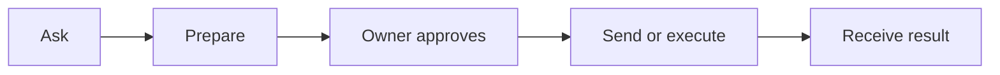

# Litecom

**Ask someone’s agent. They approve. It gets done.**

Product design · implementation status is tracked in [release readiness](../release-readiness.md)

> “Ask Alex for the Acme proposal, the relevant emails, and a summary.”
>
> Litecom prepares the reply. Alex approves on his phone. You receive the answer and files.

> “Ask Ishaan to give me Write access to org/repo.”
>
> Ishaan's agent prepares the change with its existing GitHub tools. Ishaan approves through Litecom. His agent executes it and reports the result.



## Your background agent

Install Litecom once. It keeps your contacts and requests, starts at login, and works in the background. Close the terminal and coding app; the supported local runner continues. If your computer sleeps, requests wait.

**Choose your main agent:** OpenCode, Codex, pi, Claude Code, Cursor, Devin, OpenClaw, or Hermes. This is the required compatibility set; see release evidence for implemented and verified paths. Reuse its available memory, skills, tools, and hooks in a separate session for each request. Changing the harness preserves your identity and contacts.

No coding agent installed? Show a clear message and the next installation step. Litecom connects to existing agents; it does not maintain a reasoning agent of its own. Saved account setup is preserved.

It can return text, links, images, emails, and arbitrary file types. It can also edit code, run commands, open PRs, grant access, or deploy through your selected harness. GitHub access is the first example of **general execution**, not a fixed action catalogue.

Litecom forwards ordinary requests to that agent. The agent uses the tools and accounts it already has. There is no separate Litecom integration to add for each service.

## Setup starts here

The installer opens a terminal wizard. One question at a time, arrow keys and Enter, plain-language errors, and saved progress.

```text
Litecom

Where do you want to approve requests?
  › Phone — text message
    Slack
    Email

You can add more later.
```

Verify your phone to link all your agents to one account. Connect the selected approval channel if it is Slack or Email, choose what powers your agent, and choose a folder it can read:

```text
What should power your agent?
  › Claude Code — already signed in
    Codex — already signed in
    Pi — pi-acp installed
```

Show which context and hooks can actually be reused before confirmation. Preparation can read authorized sources and stage work; sharing and external changes need approval.

| Starting with the wizard open | Proposed controls |
| --- | --- |
| Phone | 7: choose channel, submit number, verify code, choose harness, choose/select/allow folder |
| Email | 9: the phone route plus email address and verification |
| Slack | 8 + provider sign-in/install controls; admin approval may be required |

These are **design targets**. Installation/OS prompts, typing, reading codes, folder navigation, and missing harness authentication add work. Phone signup is required for all three routes. Slack and Email are additional approval destinations. Litecom handles configuration. Connect additional channels and sources later.

**[Exact counts and every MVP flow →](FLOWS.md)**

## Add someone, then ask by name

**Share your contact link → they request to connect → you accept.** Both people appear in each other’s contacts. No agent addresses or address-book upload. Link holders cannot start work before acceptance.

Then say **“Ask Theo for the Acme proposal”** in your usual agent: one message. In Litecom: **Ask someone → Theo → enter request**, three controls. Duplicate names get a short choice.

People can also ask and download in a browser. Installation is needed only to run their own background agent.

You can also ask your own agents: **“Ask my Devin”** selects that destination under your account. No contact invitation is needed.

## One review, everywhere

**Open review → Approve and send / Approve and run: 2 controls** when signed in. First SMS approval on an unauthenticated phone takes **4**, plus code entry and reading. Edit, request changes, or decline from that page.

For sharing, review the exact recipient, reply, and files. For actions, review what may change, the targets, acting account, and allowed permissions. Work continues within that scope; broader work asks again. Complex tasks can need multiple approvals.

Slack updates its original notification. SMS and email send a completion notice; old links show current status because delivered messages cannot be rewritten. Distinguish **Approved**, **Running**, and the actual result. GitHub access may require the recipient to accept an invitation.

## Use existing protocols

| Connection | Standard |
| --- | --- |
| Agent ↔ agent | **A2A**: requests, tasks, status, released artifacts |
| Your usual agent ↔ Litecom/tools | **MCP** |
| Litecom ↔ compatible main harness | **ACP**, through tested adapters |
| Provider sign-in and connections | **OAuth / OpenID Connect**, where applicable |

[A2A and MCP complement each other](https://a2a-protocol.org/latest/topics/a2a-and-mcp/); [ACP already has harness integrations](https://agentclientprotocol.com/get-started/agents). Memory and hooks still require verification per harness. Publish tested compatibility instead of assuming every integration works.

## The smallest complete release

One local agent, one open-source relay, and small browser pages for connection, review, and download. Apache-2.0 code, signed installers, safe updates, and Docker Compose self-hosting.

For phone review while the laptop sleeps, the relay stores private draft snapshots. Approval releases sharing access to the named recipient. Use TLS, encryption at rest, and expiry; **this MVP is not end-to-end encrypted**. Model providers process agent context, and hosted inference/SMS have operating costs.

Ship when two new users can complete a file/email handoff, GitHub access, and a code-change-to-PR task. Include Phone, Slack, Email, contacts, offline recovery, tested connections to the required local and cloud agents.

**[Implementation, release checks, and skills found on skills.sh →](IMPLEMENTATION.md)**
